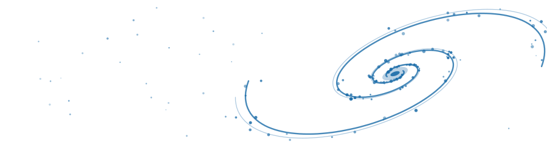

I am a PhD candidate in Physics and Astronomy at the University of Louisville, advised by Dr. Benne Holwerda. My papers are listed on [Google Scholar](https://scholar.google.com/citations?user=1psyhjcAAAAJ) and [ORCID](https://orcid.org/0009-0007-5632-9744).

I study whether galaxies build their stars in short, random bursts or decline smoothly over long periods. Gas accretion, mergers and feedback can raise a galaxy's star formation rate, while ram pressure stripping and negative feedback can lower it, and I want to know how often each happens. I am also interested in how Active Galactic Nuclei (AGN) affect star formation in their host galaxies.

I also write about physics and astronomy for [Science ABC](https://www.scienceabc.com/author/pshikha/).

See my [research](/research/) for details and my [CV](/cv/) for talks, teaching and service.
