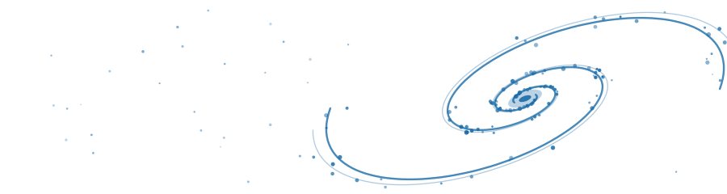
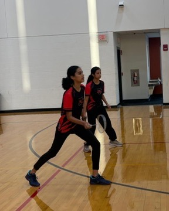

## Hi

I am Shikha Pandey, a PhD candidate in Physics and Astronomy with a research focus on star formation and galaxy evolution. I use observational data, particularly galaxy spectra, to investigate star formation properties and understand the physical processes that shape galaxies and drive their evolution over cosmic time.
I also enjoy explaining astronomy to general audiences, through public talks and science writing.

You can find my papers on [Google Scholar](https://scholar.google.com/citations?user=1psyhjcAAAAJ) and [ORCID](https://orcid.org/0009-0007-5632-9744).

## Research interests

I study whether galaxies build their stars in short, random bursts or decline smoothly over long periods. Gas accretion, mergers and feedback can raise a galaxy's star formation rate, while ram pressure stripping and negative feedback can lower it, and I want to know how often each happens. I am also interested in how Active Galactic Nuclei (AGN) affect star formation in their host galaxies.

See my [research](/research/) for details and my [CV](/cv/) for talks, teaching and service.

## Beyond research

Away from my desk, I regularly head to the Rec Center for badminton, a game I have played ever since I came to UofL. My friends there are highly skilled, which keeps every match challenging and fun.

I also go out for an occasional run, and I have completed one mini marathon so far, with hopes of lining up for another soon. For slower moments, there are books, TV shows and movies.
