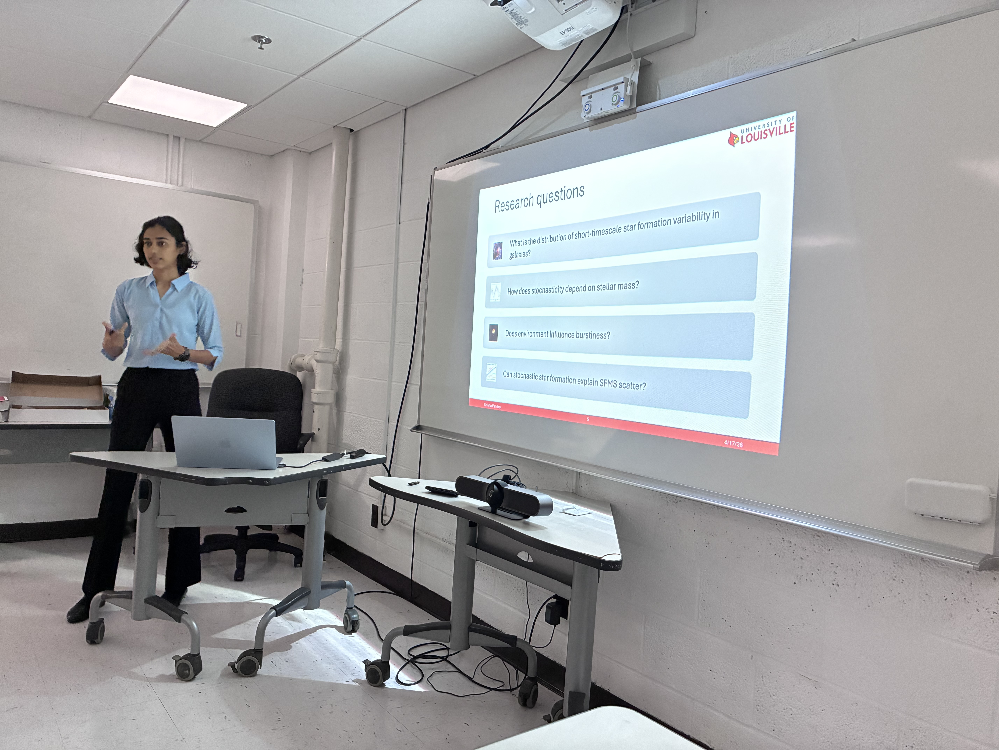

<h2>Bio</h2>  

 My focus is on understanding "Stochasticity of star formation histories." Physical processes like positive feedback, gas accretion or mergers can increase the star formation rate of the galaxy, but it can also decrease due to ram pressure stripping, negative feedback and more. These processes influence galaxy evolution, and I study whether they occur in short, random bursts or over a long period.

I am also interested in studying feedback processes in Active Galactic Nuclei. Whether or not AGN accelerates or decelerates star formation in galaxies. It is known that they play an important role in influencing the host galaxy's stellar population but quantifying their exact impact remains extremely challenging due to the complexity of galactic environments and observational limitations.

   

<h2>Current research</h2>

I am a PhD candidate in Physics and Astronomy at the University of Louisville, advised by Dr. Benne Holwerda. My current project, <em>Stochastic Star Formation in Galaxies</em>, uses optical H&alpha; and UV emission to study star formation histories, including bursty and declining phases. I am building a spectrophotometric calibration pipeline for LADUMA spectra from the Anglo-Australian Telescope and using the H&alpha; lines in the Chandra Deep Field South to estimate star formation rates.

<h2>Education</h2>
<ul>
  <li>PhD Candidate in Physics and Astronomy, University of Louisville (2024 – present)</li>
  <li>M.Sc. in Physics (Astrophysics), St. Xavier's College, Mumbai University (2021 – 2023)</li>
</ul>
