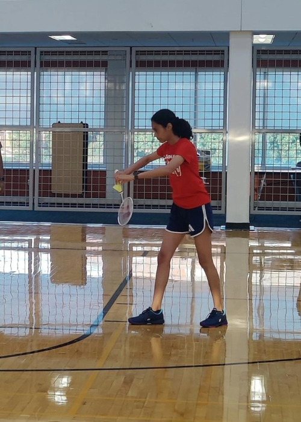
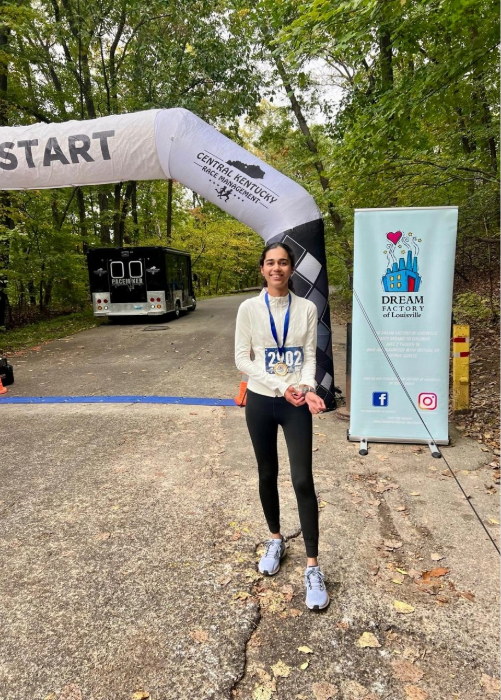
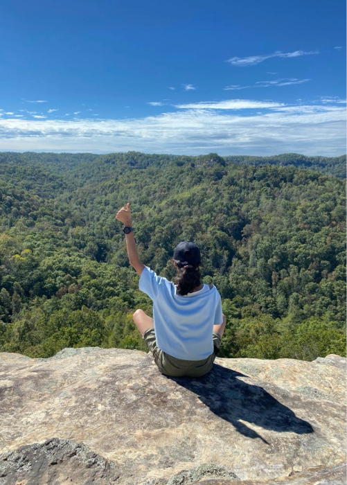
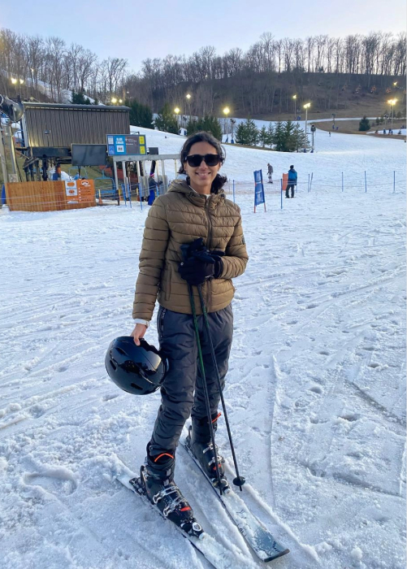

<h1 class="life-title">Beyond Research</h1>

<h2 class="activity-title">Badminton</h2>

I enjoy playing badminton at the UofL Rec Center. While I consider myself an average player, I regularly practice with highly skilled friends, which makes the games both challenging and fun.

<h2 class="activity-title">Running</h2>

Since starting my PhD, I’ve tried to maintain an intense workout routine, and running has quickly become my sport of choice. I’m up to about five miles and still building my endurance for a mini marathon this April!

<h2 class="activity-title">Hiking</h2>

Spending time in nature through long hikes along scenic trails is one of my favorite ways to relax and recharge.

<h2 class="activity-title">Skiing</h2>

Only one skiing trip so far, but it turned out to be one of the best experiences — definitely looking forward to going again.

