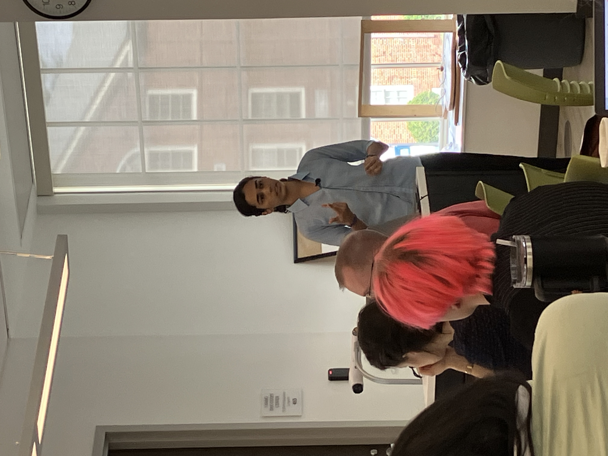

<figure style="text-align: center !important; margin: 1.5em auto; max-width: 400px; border: 1px solid #eee; padding: 10px; border-radius: 12px; box-shadow: 0 4px 12px rgba(0,0,0,0.05); background: #fff;">
  
  <figcaption style="margin-top: 10px; font-size: 0.9em; color: #666; text-align: center !important;">
    <i>At Berea College</i>
  </figcaption>
</figure>

I spoke about research work done in my Master's where we worked on studying stellar populations in Active Galactic Nuclei. We investigated whether feedback from AGN influences star formation using photometric observations form optical telescopes. 

