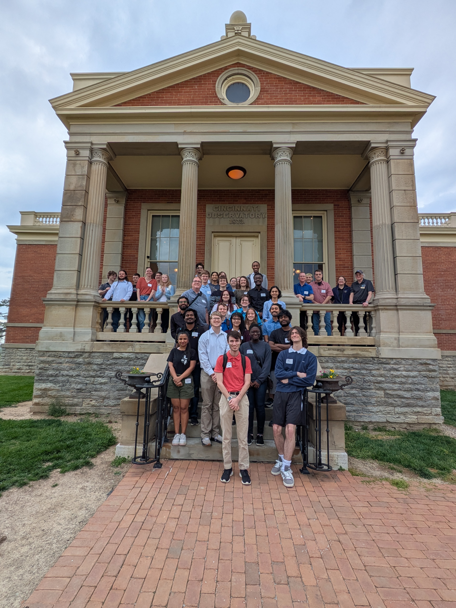

<figure style="text-align: center !important; margin: 1.5em auto; max-width: 400px; border: 1px solid #eee; padding: 10px; border-radius: 12px; box-shadow: 0 4px 12px rgba(0,0,0,0.05); background: #fff;">
  
  <figcaption style="margin-top: 10px; font-size: 0.9em; color: #666; text-align: center !important;">
    <i>At the Cincinnati Observatory</i>
  </figcaption>
</figure>

Constraining star formation histories for populations of galaxies has become considerably easier due to multiwavelength galaxy surveys thanks to ground and space based telescopes. However, it is still not clear as to why galaxies go through bursts and coast phases instead of following a smooth decline in star formation activity.  

